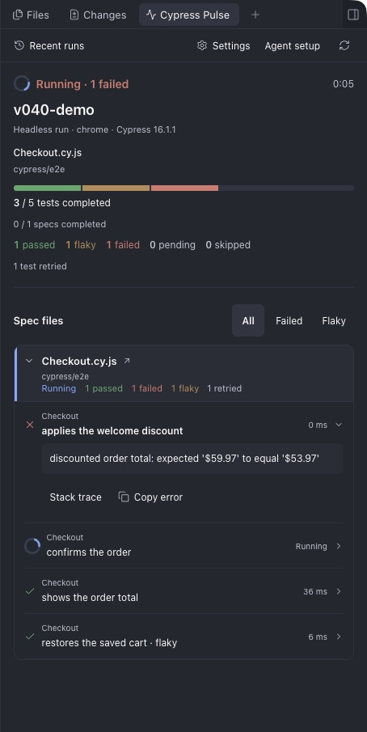
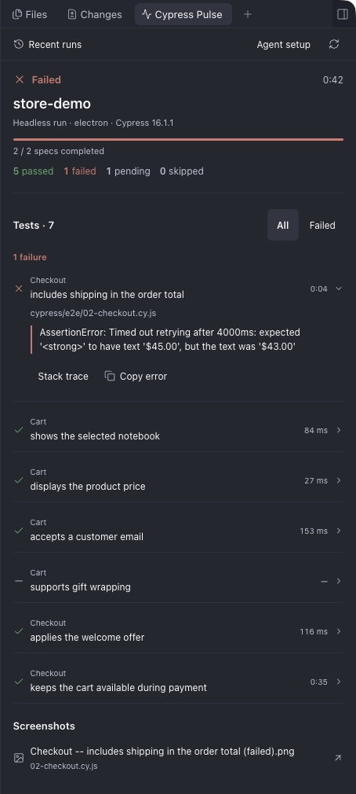
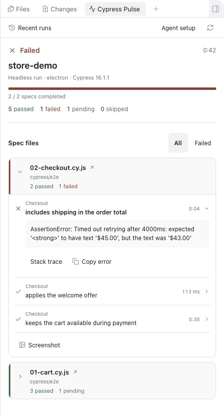
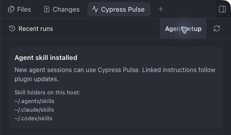
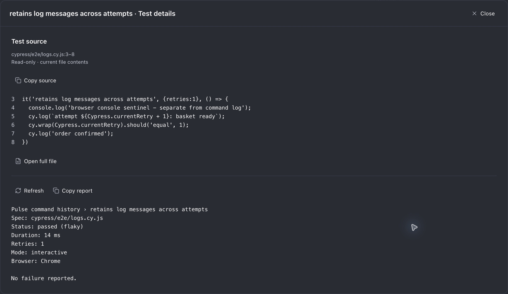
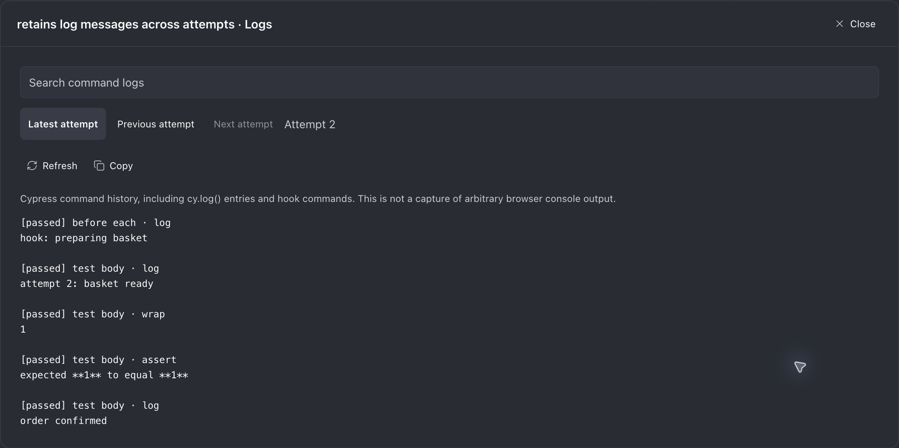
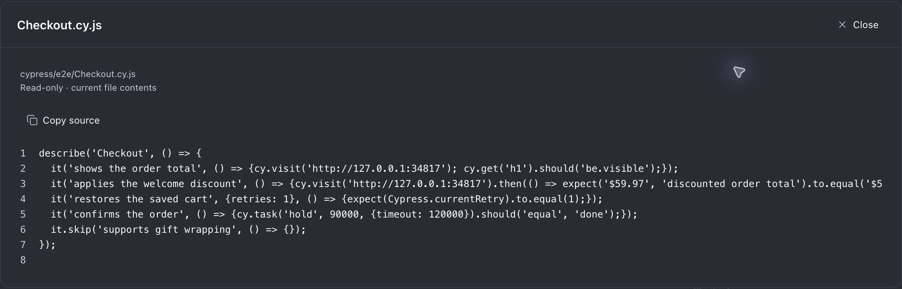
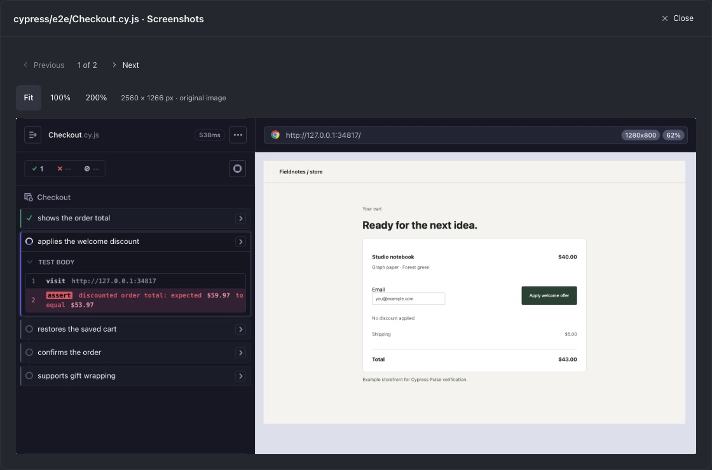
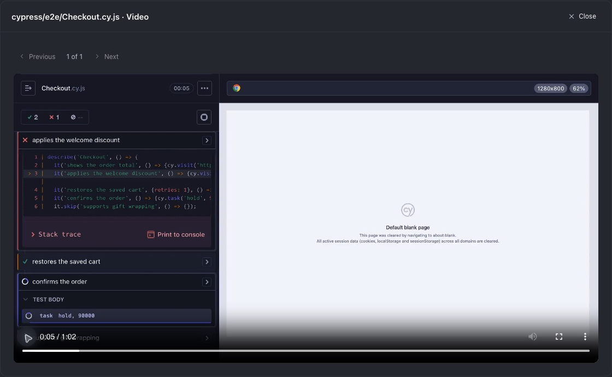
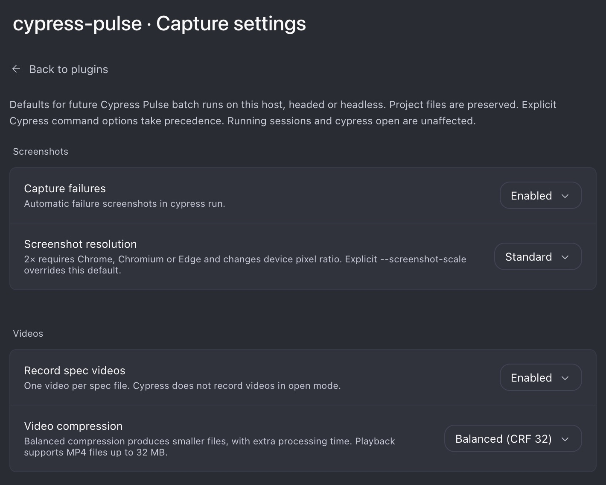

# Cypress Pulse

Current version: **1.0.0** · [Release notes](RELEASE_NOTES.md) · [Release procedure](RELEASING.md)

Watch Cypress tests from Paseo’s Explorer panel while your agent works. Follow live spec progress, browse tests grouped by their spec file, inspect source, and browse screenshots and spec videos without leaving the workspace. A header indicator keeps the run visible when the panel is closed.

The npm package name is **`paseo-cypress-pulse`**. Paseo’s plugin ID, the helper command, and the agent skill remain `cypress-pulse`; the GitHub repository remains `mbranicky/cypress-pulse`.

Standalone plugin, inspired by [Playwright Pulse](https://github.com/stevecastaneda/paseo-plugins/tree/main/playwright-pulse#readme). Your tested projects keep their existing sources, configuration, and dependencies.

<p>
  
  
</p>

These are real Paseo desktop captures of an isolated example storefront. One assertion deliberately fails and another passes on retry to demonstrate failure and flaky reporting. Captures are cropped to the plugin panel or preview dialog.

<details>
<summary>Light theme example</summary>



</details>

## Get started

```sh
paseo plugin install npm:paseo-cypress-pulse@1.0.0
```

For installation from Git, use `paseo plugin install github:mbranicky/cypress-pulse --ref paseo-cypress-pulse-v1.0.0`.

1. Open a project workspace in Paseo, then choose **Open Cypress Pulse** in the Command Center. The panel opens in Explorer.
2. Click **Install skill** in the panel. It adds user-level skill links on the daemon host in `~/.agents/skills`, `~/.claude/skills`, and `~/.codex/skills`.
3. Start a new agent session and ask it to use the **cypress-pulse** skill when running your tests.

For example: “Use Cypress Pulse to run the checkout tests, keeping this project’s usual startup and test settings.”



The installer runs only when clicked. Existing files or links owned by another installation are skipped. Linked instructions follow plugin updates; if Paseo moves its installed copy, the panel offers **Update skill**. **Agent setup** shows the current status and folders at any time.

## Requirements

| Component            | Supported versions      |
| -------------------- | ----------------------- |
| Paseo app and daemon | `>=0.11.2 <0.12.0`      |
| Project Cypress      | `>=16.0.0 <17.0.0`      |
| Helper Node.js       | `^22.18.0` or `^24.0.0` |

## Using the panel

- **Recent runs** switches between independent executions, including concurrent runs in the workspace.
- The summary shows browser, run mode, elapsed time, completed tests and specs, outcomes, and retries. Spinners in the panel and workspace header indicate an active run.
- The segmented progress bar distinguishes passed, failed, flaky, pending, and skipped tests. A **flaky** test passed after retrying; it is counted once, separately from clean passes in the legend. Batch totals are labeled **known tests** until all specs have loaded because Cypress does not know the contents of unevaluated files.
- Tests are grouped by **spec file**, with outcome and retry counts in each header. Running and failing files appear first and start expanded; completed files start collapsed. Click the chevron, folder path, counts, or card background to expand or collapse a file. Test-detail and screenshot controls keep their own actions.
- Click only the **filename or adjacent arrow** to read its current source, with line numbers and **Copy source**. Desktop source dialogs are up to 1120 px wide, and shrink to fit smaller screens. This is a read-only preview inside Paseo; native editor tabs are not exposed by Paseo 0.11.2’s plugin API.
- Failures appear first inside each file. Expand a test for its message; **Stack trace** and **Copy error** provide more detail. **Failed** shows only failing files and tests, while their headers keep the full file counts. **Flaky** shows only files and tests that passed after a retry. **Skipped / Disabled** shows Cypress skipped and pending tests (including disabled tests). Queued tests in an active interactive run are excluded.
- **Search tests and files** matches file paths and full test titles (including suite names), case-insensitively. Search combines with the selected status filter and scans all tests before the 300-detail display limit. Clearing the field restores the selected filter’s results. Run and file counts remain unchanged.
- Expand any test for **Test details** and **Logs**. Details include the test declaration with original line numbers, the spec, status, duration, retries, browser, mode, and available failure diagnostics. **Copy source** copies the snippet; **Open full file** opens the existing full-spec source preview. Source is read-only current file content. The parser matches the full suite/test title and reports unavailable or ambiguous declarations instead of guessing. Interactive **Logs** shows Cypress command history (including `cy.log()` and hook commands), with search, copy, refresh, and retry-attempt navigation. It does not capture arbitrary browser `console.log()` output. Logs are read from the original live session and run; rerunning or closing that session can make them unavailable. Batch runs explain that command logs were not captured.
- **Screenshots** opens a gallery of Cypress-generated images from the matching file section. Use **Previous** and **Next** inside the dialog. The wider viewer preserves the original image and offers **Fit**, **100%**, and **200%** with scrolling. Batch screenshots belong to a spec; the plugin does not guess which test owns an image from its filename.
- **Video** opens the Cypress-generated MP4 for a spec, with playback, seeking and fullscreen controls on desktop/web. Cypress records **one video per spec file**, only in `cypress run` (headed or headless), when recording is enabled. Open mode does not record video. Media controls appear when the run reports the artifacts. Images are limited to 8 MB and videos to 32 MB; native mobile clients show a playback availability message.
- Completed test results update while their spec is still running, in both batch and interactive mode. Interactive runs offer **Spec report** during execution and **Read failure** for completed failures. After the spec finishes, the first five failure messages load automatically. Queued interactive tests are not counted as completed pending tests.

<details>
<summary>Test details and command logs</summary>




</details>

<details>
<summary>Source preview example</summary>



</details>

<details>
<summary>Failure screenshot viewer</summary>



</details>

Pending/skipped-only executions are marked **No executed tests**, so they cannot be mistaken for a successful verification.

<details>
<summary>Spec video player</summary>



</details>

## Capture settings

Open **Settings** in the panel, or **Settings → Plugins → Cypress Pulse → Capture settings**. Defaults are shared by clients of this daemon host and survive plugin updates:

- **Capture failures:** use the project's setting, enable, or disable automatic run-mode failure screenshots.
- **Screenshot resolution:** standard or optional 2× capture for Chrome, Chromium and Edge. This changes device pixel ratio; `--screenshot-scale 1` or `2` overrides it per run.
- **Record spec videos:** use the project's setting, enable, or disable recording.
- **Video compression:** use the project's setting, uncompressed, or balanced CRF 32 to reduce file size.



Settings apply to future **Pulse helper batch runs**, including headed runs. Active runs and `cypress open` are unaffected. Defaults initially preserve project settings and use standard resolution. Existing environment overrides and explicit Cypress `--config` options take precedence over saved capture defaults. Project sources/configuration are never edited. Project setup hooks can still customize the resolved configuration.

See [Cypress's screenshot and video guide](https://docs.cypress.io/app/guides/screenshots-and-videos) for capture behavior.

## Running tests yourself

The plugin installs a dependency-free helper at `~/.local/share/cypress-pulse/cli.mjs`. Check a project:

```sh
node ~/.local/share/cypress-pulse/cli.mjs doctor --project /absolute/path/to/project
```

Launch a monitored batch run:

```sh
node ~/.local/share/cypress-pulse/cli.mjs run --project /absolute/path/to/project -- --spec cypress/e2e/checkout.cy.ts --browser chrome
```

Add `--headed` after `--` for a visible batch browser. This still uses Cypress run-mode behavior and retries. For interactive UI mode, use `cypress open` as described below. Arguments after `--` are Cypress run options. Keep the project’s usual application startup, environment, and test selection. Use helper `--config-file` for an alternative configuration. Reporter overrides are preserved; explicit reporter options must be a JSON object.

For higher-resolution failure captures, opt in for an individual batch run:

```sh
node ~/.local/share/cypress-pulse/cli.mjs run --project /absolute/path/to/project --screenshot-scale 2 -- --spec cypress/e2e/checkout.cy.ts --browser chrome
```

This asks Chrome, Chromium, or Edge to use a 2× device pixel ratio. The configured Cypress viewport stays unchanged, but pixel ratio can affect visual assertions. Standard resolution is the initial default; a saved 2× setting also enables scaling. Electron and Firefox are not supported by this option. It cannot change images already captured by an interactive session. A headless Chrome verification produced 2560 × 1266 pixels instead of 1280 × 633. See [Cypress’s browser-launch documentation](https://docs.cypress.io/api/node-events/browser-launch-api#Set-screen-size-when-running-headless).

The helper imports the project’s existing configuration through a temporary wrapper outside the repository, composes its hooks, and delegates to its reporter. Before loading any project code, it restores the original configuration directory as the config process working directory, matching a native Cypress invocation. This preserves relative file reads and named webpack loader resolution, including when the config lives below the project root. It never edits project configuration or dependency manifests. Tests generate artifacts according to resolved Cypress configuration, including capture defaults and explicit invocation overrides.

For interactive tests, start **cypress open** normally and choose a Chromium-family browser. The plugin observes the session through the project’s own **cypress tap** CLI; no support-file instrumentation is needed. At a monorepo root, discovery needs a reachable Cypress installation or a previously observed batch run identifying the Cypress project.

## Limits and local data

An already running, uninstrumented batch invocation cannot be attached. Interactive monitoring currently supports Chromium-family browsers. This version observes tests; it has no stop or rerun controls.

The panel lists 30 recent runs and up to 300 test details for the selected run, with failures and running tests first. Run and file counts cover the full execution, including tests outside the detail limit. Source previews read only specs identified by the run, inside the workspace, with a 1 MiB limit; long lines can be scrolled horizontally. Screenshot previews accept PNG/JPEG files up to 8 MiB; video previews accept MP4 files up to 32 MiB. Telemetry reads have a 32 MiB limit; exceeding it produces a notice. Interactive reports are checked against the session and run identity before and after reading.

Run data is stored on the daemon host in `~/.local/state/cypress-pulse` and sent through Paseo to connected clients when viewed. Agent-invoked helper output can also enter the agent conversation and reach its configured provider. `CYPRESS_PULSE_STATE_DIR` or helper `--state-dir` can override it; the daemon and helper must use the same location. It includes saved capture defaults, test titles, failure text, and artifact paths, without copying project configuration or environment variables. The helper’s `show --run-id ID` command returns normalized JSON for agents. No Cypress Cloud account is required. History is not automatically deleted; display limits do not limit disk retention. Runs whose original project or worktree has been removed are quietly omitted from the panel; their saved journals remain on disk. Workspace aliases are resolved before filtering, and symlink paths escaping the workspace are excluded. Incomplete snapshots during run creation or cleanup are skipped, while corrupt records, inconsistent run identities and unexpected filesystem failures produce notices. A missing selected workspace remains an error. Direct `show --run-id ID` access to a saved run whose project is unavailable reports that the project no longer exists. See [data retention and removal](RELEASING.md#data-retention-and-removal) for cleanup guidance.

## Development and verification

[GitHub Actions](https://github.com/mbranicky/cypress-pulse/actions/workflows/tests.yml) runs typechecking, unit tests, and Cypress integration tests for pull requests targeting `main` and every push to `main`, using Ubuntu with Node 22.18.0 and 24.x. PR tests run when a pull request is opened, reopened, updated with new commits, or marked ready for review. The workflow also supports manual runs. It audits production dependencies and verifies a clean production-only npm package, including Git dependency preparation and real Cypress runs through the packaged helper.

```sh
npm ci
npm run check
npm run test:package -- --integration
paseo plugin install /absolute/path/to/cypress-pulse
```

The integration suite requires installed Chrome for live-progress and screenshot-resolution verification.

After changes, typecheck and run `paseo plugin reload cypress-pulse`.

Unit tests cover reporting, retries, empty runs, interruption, runtime gates, session targeting, report freshness, skill installation with ownership protection, file grouping, and source-preview boundaries. Integration tests run real Cypress against isolated CommonJS, ESM, and TypeScript configurations, checking asynchronous hooks, tasks, reporter preservation, and unchanged source checksums. The live regression observes passed, failed, and flaky outcomes before spec completion, then checks that optional 2× capture doubles failure PNG dimensions. Additional regression tests compare native and monitored runs with `@cypress/webpack-preprocessor`, named `ts-loader`, TypeScript support files, and aliases. They cover both a root CommonJS config and a nested ESM TypeScript config, including relative reads during config import, tasks, and later hooks.

Verified with Paseo 0.11.2 on macOS, Cypress 16.1.1, and Cypress 16.0.0 for the minimum-version batch path. Live interactive Electron sessions, reruns, failure messages, batch screenshot previews, one-click skill installation, grouped file sections, source previews, narrow Explorer layouts, and Ghostty/Light themes were checked in the desktop app. Compatibility checks used Node 22.18.0 and 24.16.0. The webpack regression cases also passed on Cypress 16.0.0 with Node 22.18.0 in headed Chrome. Chrome open-mode partial results were also verified on Cypress 16.0.0 with Node 22.18.0. Live partial results, live failure reports, spinners, card interactions, wide source dialogs, original-pixel image zoom, and a 320 px Explorer panel were verified in Paseo for 0.4.0.

Ubuntu batch integration tests pass in CI on both supported Node lines. Windows, Linux desktop, and mobile clients are not yet verified. Component tests are outside the current compatibility matrix. Supported ranges are enforced; unusual project plugins and configurations may need further compatibility testing.

Webpack, its Cypress preprocessor, and ts-loader are pinned development-only regression dependencies. They are not installed in monitored projects or required by the helper.

Collectors, installer, and launch helper use Node’s standard library. The client uses Paseo’s host-provided modules. Cypress is a development-only dependency; monitored projects use their existing installation.

[MIT license](LICENSE).

Version 0.5.0’s Flaky filter, screenshot gallery navigation, generated spec-video playback and host capture settings were verified in the local Paseo desktop app. See [release notes](RELEASE_NOTES.md) for the version history.

Test source extraction uses the pinned TypeScript parser as a plugin runtime dependency. It parses declarations without importing or executing test code. The batch helper remains dependency-free; monitored projects need no added packages.

The npm release artifact is prepared with `npm run pack:release`. Git installations run locked production dependency preparation; npm artifacts omit that redundant step. See the [release procedure](RELEASING.md) before versioning or publishing.

The current preparation findings and remaining publication gates are recorded in the repository [release-readiness report](https://github.com/mbranicky/cypress-pulse/blob/main/RELEASE_READINESS.md).
